# Mailslot

<p align="center"></p>

<p align="center">
  
  
  
</p>

Mailslot is a private drop slot for files. Start sharing, hand out the link, and files sent to it land in a folder on your computer with a checksum. Nothing is ever served back. It also sends: the same app and command line push files to another Mailslot, and interrupted transfers pick up where they stopped.

> **Status:** pre-alpha. It works from source today. Packages arrive with the first release.

## What it's for

- Getting a file from an AI agent, a build server or a friend without setting up an account or a cloud drive.
- Moving photos from your phone to your computer over Wi-Fi: scan the QR code, pick the photos.
- Sending files to another machine from a terminal, with resume and no duplicates.

## Install

The first release will ship as a Flatpak, an AppImage, `.deb` and `.rpm` packages, and a Linux command-line tarball. Until then, build from source with a recent Rust toolchain and GTK 4.20 and libadwaita 1.8 or newer:

```sh
cargo run -p mailslot-gtk        # desktop app
cargo run -p mailslot-cli -- --help   # command line only, no GTK needed
```

Ubuntu 24.04 is too old for the desktop app. The Flatpak and AppImage cover older distributions.

## First run

1. Open Mailslot and press **Start**.
2. Copy the link, or scan the QR code with your phone.
3. Send a file. It appears in the Incoming list and in `~/Downloads/Mailslot`.

## Receiving

Anyone with the link can send you files. They can:

- open the link in a browser and drag files onto the page (it works on phones),
- run `curl -T photo.jpg http://192.168.1.20:8931/<token>/photo.jpg`,
- use Mailslot's own client.

Every file arrives with a SHA-256 checksum, shown in the app and returned to the sender, so you can compare it with `sha256sum`. The link menu has ready-made `curl`, PowerShell and `wget` commands, and a block of instructions you can paste into an agent session.

Choose **New link** to end the old link at once.

## Sending

From the **Send** page, pick files or folders, or paste a Mailslot link. From a terminal:

```sh
mailslot-cli send report.zip 'mailslot://192.168.1.20:8931/<token>'
tar c project | mailslot-cli send --name project.tar - 'mailslot://…'
```

Uploads resume after a dropped connection, retry with backoff, and skip files the other side already has. `--json` prints progress for scripts.

On a server with no screen, `mailslot-cli serve` receives files without the desktop app.

## Security in plain words

- The link is the password. Anyone who has it can send you files, so share it only with people and agents you trust, and use **New link** if it leaks.
- Nobody can see or download what is in your folder. Wrong guesses all look the same, and Mailslot never opens or runs what it receives.
- Links expire after an hour by default, and you can stop after a number of files or a time.
- On your home network, plain HTTP is fine. Over the internet, turn on HTTPS in Preferences.
- **Open to the internet** asks your router to forward the port using UPnP. It is off by default, lasts an hour at a time, shows an "Internet-exposed" warning while it's on, and is removed when you stop. If you don't want that, forward a port by hand and remove it afterwards.

More in [docs/security.md](docs/security.md).

## Documentation

- [SPEC.md](SPEC.md) — behaviour, protocol and settings
- [docs/security.md](docs/security.md) — threat model
- [docs/architecture.md](docs/architecture.md) — layers, and using the engine from your own app
- [docs/development.md](docs/development.md) — building, testing and running in Docker
- [docs/packaging.md](docs/packaging.md) — package formats
- [AGENTS.md](AGENTS.md) — contributor and agent rules

## Contributing

Run `make validate` before opening a pull request. The rules are in [AGENTS.md](AGENTS.md).

## Part of Liminal HQ

Mailslot is a [Liminal HQ](https://github.com/liminal-hq) project. Digital tools for the spaces in between.

## Licence

Licensed under either of the [Apache License, Version 2.0](LICENSE-APACHE) or the [MIT licence](LICENSE-MIT), at your option.
