# Architecture

Mailslot is a library with thin shells on top. `mailslot-core` holds every behaviour and has no GTK or UI dependency; the GTK app, the CLI and the IPC daemon each drive one `Engine`. This page is for people who want to understand or extend that structure. Behaviour and the HTTP contract are in [SPEC.md](../SPEC.md), the threat model in [security.md](security.md) and the reasons behind the choices in [decisions.md](decisions.md).

- [System overview](#system-overview)
- [Crates and layers](#crates-and-layers)
- [The engine contract](#the-engine-contract)
- [Threading model](#threading-model)
- [Logging](#logging)
- [Upload lifecycle](#upload-lifecycle)
- [Port mapping](#port-mapping)
- [mailslotd and the IPC API](#mailslotd-and-the-ipc-api)
- [Writing a new frontend](#writing-a-new-frontend)
- [Embedding in a Rust or Tauri app](#embedding-in-a-rust-or-tauri-app)
- [Data, errors and boundaries](#data-errors-and-boundaries)

## System overview



- **Senders** are anything that can make an HTTP `PUT`: the drop page in a browser (often on a phone that scanned the QR code), `curl -T`, `mailslot-cli send` and `watch`, or the Send page of another Mailslot. All of them address `/<token>/<name>` on the receiver.
- **The receiver** is one engine in one process. Its HTTP server streams each upload into the destination folder (`~/Downloads/Mailslot` by default) and never serves a file back.
- **The router** is involved only when the user turns on "Open to the internet". The engine then leases a port mapping with UPnP-IGD, or PCP or NAT-PMP, renews it and removes it when sharing stops.
- **mDNS** is opt-in. The engine announces `_mailslot._tcp` with the port and the link label, never the token, so a nearby sender still needs the link.
- **Frontends** (`mailslot`, `mailslot-cli serve`, `mailslotd`) send commands to the engine and draw what its events and state snapshot say.

## Crates and layers



Dependencies only point down: frontends depend on `mailslot-core`, and core depends on nothing of theirs. `mailslot-core` has no GTK, GLib or UI dependency, and the CI `core-embed` job builds it on a runner without GTK.

| Crate | Module | Responsibility |
|---|---|---|
| `mailslot-core` | `engine` | `Engine`, `EngineBuilder`, `SendRequest`, `EventStream`: lifecycle, the event pump, expiry and auto-stop timers, the port-mapping task and send tasks |
| | `events` | `Event` and its parts (`UploadEvent`, `SendEvent`, `InternetEvent`, `InternetState`, `Diagnostic`) and the `EngineState` snapshot |
| | `server` | `Server` (accept loop on hyper with HTTP/1 and HTTP/2, optional TLS); `handler` routes and checks the token, `upload` streams `PUT` and answers `HEAD`, `support` has the lockout, rate limiter, free-space probe and hash index |
| | `client` | `Client`: hash, `have?`, `HEAD` offset, resumable `PUT`, retries with backoff, bandwidth cap, `send_many`, `send_stream` |
| | `portmap` | `open`, `cleanup_stale`, `ActiveMapping::renew` and `remove`, NAT diagnostics |
| | `discovery` | mDNS `Advertiser` and `browse` |
| | `watch`, `outbox` | Debounced folder watcher and the persisted queue behind `mailslot-cli watch` (the only persisted send queue; the app's Send page does not persist its sends) |
| | `config` | `Config` and its sections, `Paths`, loading and saving `config.toml` and the token |
| | `proto` | Header names, routes, capabilities, the CSP and `MailslotLink` (`mailslot://` links) |
| | `naming`, `token`, `history`, `netinfo`, `snippets`, `tls`, `error` | Filename sanitizing and collision names, the secret and its constant-time compare, `history.jsonl`, LAN addresses and the opt-in public-IP lookup, copy-paste snippets, the self-signed certificate and its pin, `Error` |
| | `redact`, `diagnostics` | Token redaction and the plain-text diagnostics report |
| `mailslot-log` | `init`, `RotatingFile`, `Redacting` | The frontends' `tracing` subscriber: environment filter, private size-capped log file written through a non-blocking appender, secret redaction and the log tail reader |
| `mailslot-ipc` | `protocol`, `server`, `client` | JSON-RPC types and codes, `Daemon` and `bind`, and a Rust `Client` for the same socket |
| | `bin/mailslotd` | The headless daemon |
| `mailslot-cli` | `serve`, `send`, `watch`, `misc` | `serve` drives an `Engine`; `send`, `watch`, `pair` and `status` use `client::Client` directly |
| `mailslot-gtk` | `application`, `bridge`, `window`, `preferences`, `model`, `widgets`, `qr`, `i18n` | Builds the engine, consumes its events on the main loop, and draws the Share and Send pages, Preferences, rows and the QR code |

`mailslot-core` features, all on by default:

| Feature | Adds | Main dependencies |
|---|---|---|
| `server` | The HTTP server and the `Engine` | axum, hyper, hyper-util |
| `client` | `client::Client`, and `Engine::send` when `server` is also on | reqwest |
| `portmap` | UPnP-IGD, PCP and NAT-PMP | igd-next, crab_nat, netdev |
| `tls` | Self-signed HTTPS and key pinning | rustls, tokio-rustls, rcgen |
| `watch` | Folder watching and the outbox (implies `client`) | notify |
| `discovery` | mDNS advertising and browsing | mdns-sd |

A program that only sends uses `default-features = false, features = ["client"]` and links neither axum nor the engine. The `Engine` itself needs `server`.

## The engine contract



A frontend needs exactly three things from the engine: commands, events and a snapshot.

- **Commands** are `async fn`s on `Engine`: `start`, `stop`, `pause`, `resume`, `rotate_token`, `update_settings`, `set_internet_exposed`, `send`, `check_link`, `discover_peers`, `find_free_port`, `lookup_public_ip`, the history calls and `shutdown`. `cancel_send` and `clear_finished` are plain methods. Each command runs on the engine's runtime through `Handle::spawn`, so it can be awaited from any executor, including the GLib main loop.
- **Events** come from `subscribe()`, an `EventStream` of `Event`: `StateChanged` (with the full snapshot), `Upload(Started | Progress | Finished | Failed | Rejected)`, `Send(…)`, `Internet(…)`, `TokenRotated`, `SettingsChanged`, `Stopped(reason)` and `Lagged(n)`. Upload progress is throttled to every 100 ms per upload. The stream is a broadcast channel 2048 events deep; a subscriber that falls behind gets `Lagged(n)` and should call `state()` to catch up.
- **State** is `state()`, an `EngineState` snapshot: status, bound address, share URLs, expiry, TLS pin, internet state, uploads and sends this session, counters, `paused`, `restart_required` and `advertising`. The snapshot is updated before the matching event is sent, so a frontend can draw it first and then apply events.

Construction is explicit. `Engine::builder()` reads `config.toml` and the token from the XDG paths; `EngineBuilder::new(Paths::in_dir(…))` keeps them elsewhere; `.config(…)` and `.token(…)` skip the files and `.persist(false)` never writes them. The engine has no global state and creates no hidden runtime: it uses `.runtime_handle(…)`, else the current tokio runtime, else a private two-thread runtime when `.own_runtime(true)` is set, and otherwise `build()` fails. `Engine` is cheap to clone, and clones share one engine.

Settings changes go through `update_settings`. Limits and rules apply live; a new port, address, HTTPS setting or destination sets `restart_required` while sharing.

## Threading model



The GTK app builds the engine with `own_runtime(true)`, so all network and disk work runs on a two-thread tokio runtime named `mailslot`. The GLib main thread owns every widget and every `gio::ListStore`.

- **Commands** start in a signal handler as `glib::spawn_future_local(async move { engine.start().await })`. The engine spawns the work on its runtime and the main loop awaits the `JoinHandle`, so the main loop never blocks.
- **Events** cross the other way. `Bridge::run` polls `engine.subscribe()` from `glib::spawn_future_local`; the stream wraps a tokio `broadcast` receiver, which any executor can poll. `Bridge` applies each event to `UploadItem` objects in the list stores and then notifies its observers.
- **Only plain data crosses.** Events and state are `Clone + Send` values. GObjects never leave the main thread, and the engine never holds a toolkit object.

The CLI and `mailslotd` run the engine on their own `#[tokio::main]` runtime and need no bridge.

## Logging

`mailslot-core` only emits `tracing` events and never installs a subscriber, so embedders choose where they go. Each frontend (`mailslot`, `mailslot-cli`, `mailslotd`) calls `mailslot_log::init` once at start-up. The file is written from a worker thread, so nothing on the GLib main loop or the tokio runtime waits on the disk. Behaviour and the redaction rules are in [SPEC.md](../SPEC.md#logging-and-diagnostics).

## Upload lifecycle


Every request to `/<token>/…` goes through `server::handler`, and a `PUT` or `POST` continues in `server::upload`:

1. **Gate.** A locked-out address gets `404`. The token is compared in constant time, and a wrong one gets the same `404` as an unknown path and counts towards the lockout. Then the rate limit (`429`), link expiry (`410`) and pause (`503`).
2. **Admit.** The name is sanitized; the extension rule (`415`), the checksum, upload-id and `Content-Range` headers (`400`), the declared size (`413`), the session quota (`507`), concurrency (`429` with `Retry-After`), free space (`507`) and the file-count rule (`410`) are checked before a byte is written. A refusal emits `Upload::Rejected`.
3. **Stream.** The engine emits `Upload::Started` and opens `.mailslot-<key>.part` in the destination folder with `O_NOFOLLOW`, exclusively unless the upload is resumable (its key is then derived from the upload id, and a `Content-Range` start appends to it). Each chunk updates the SHA-256 and is written through a 256 KiB buffer; size, quota and (every 8 MiB) free space are checked again as bytes arrive. A stalled body times out (`408`), and rotating the token cancels uploads in flight (`410`).
4. **Verify.** A mismatch with `X-Mailslot-Expected-Sha256` or `Content-Digest` deletes the partial and returns `422`. With `verify_on_receive` the file is hashed again from disk.
5. **Claim.** `hard_link(part, name)` gives the file its final name and fails if the name exists, so Mailslot tries `stem-1.ext`, `stem-2.ext` and so on and never overwrites. The `.part` is removed, an optional `.sha256` sidecar written, the hash index and history updated, `Upload::Finished` emitted and `201 Created` returned with `X-Mailslot-Saved-As` and `X-Mailslot-Sha256`.

An aborted upload without an upload id deletes its `.part` through a guard that runs on drop. Partials kept for resuming are swept after an hour without activity. The status codes and headers are specified in [SPEC.md](../SPEC.md#http-contract).

### Resume and dedupe



`client::Client::send_file` runs this handshake, and plain `curl -T` keeps working without it:

1. Hash the file. Ask `GET /<token>/have?sha256=<hex>`; on `{"have":true}` skip the upload (`SendEvent::Skipped`). The server answers from its hash index, seeded from history at start.
2. Derive the upload id from the SHA-256 and the name, so a restarted process resumes the same upload, and ask `HEAD /<token>/<name>` with `X-Mailslot-Upload-Id`. The server answers with `X-Mailslot-Offset`, the size of the partial it holds.
3. `PUT` from that offset with `Content-Range: bytes <start>-<end>/<total>`. `202` with an offset means more is expected, `201` means done, and `409` carries the server's real offset so the client can realign.
4. On a dropped connection, retry with exponential backoff (or `Retry-After`) and start again at step 2. Finally compare the server's `X-Mailslot-Sha256` with the local hash.

## Port mapping


The engine runs one port-mapping task while sharing with "Open to the internet" on (`set_internet_exposed`, remembered in `network.upnp`):

1. `InternetState::Mapping`. With the opt-in lookup on, fetch the public address once. Remove stale mappings from earlier runs whose description starts with `Mailslot` (`InternetEvent::StaleRemoved`).
2. Search for a UPnP-IGD gateway (four seconds), read its external address and add a TCP mapping with a lease, or any free external port if the requested one is taken. Mailslot never accepts a permanent mapping. When UPnP fails it tries PCP and NAT-PMP through the default gateway.
3. `InternetState::Open { external, url, warnings }`. The lease is at most an hour and never outlives the link expiry (at least two minutes). The task renews it at half the lease.
4. Stopping cancels the task, which removes the mapping (with an eight-second limit). `stop`, `shutdown` and a closing GTK window all stop sharing, and `mailslot-cli serve` and `mailslotd` call `shutdown` on SIGTERM and SIGINT.

Every `Diagnostic` has a plain-language message and a kind. A failure becomes `InternetState::Failed` with `NoGateway`, `MappingRefused` (UPnP switched off, or only permanent leases offered), `PortConflict` or `Other`. The NAT checks arrive as `warnings` on an open mapping, because the router accepted it but the link may still not work from the internet: `DoubleNat` when the router's external address is private, `Cgnat` when it is in `100.64.0.0/10`, and `AddressMismatch` when it differs from the address the opt-in lookup saw. The exposure trade-offs are in [security.md](security.md#upnp).

## mailslotd and the IPC API



`mailslot-ipc` lets a user interface in any language drive the engine without Rust bindings. `Daemon` serves an `Engine` on a Unix socket, `mailslotd` is a ready-made process around it, and `mailslot_ipc::Client` is the Rust side of the same protocol.

- **Transport.** `$XDG_RUNTIME_DIR/ca.liminalhq.mailslot/mailslotd.sock`, mode `0600` in a `0700` directory, never TCP. One JSON object per line.
- **Methods** mirror the engine commands (`state`, `start`, `stop`, `pause`, `resume`, `rotate_token`, `settings.*`, `internet.set`, `send`, `history.*` and so on). The full table is in the [specification](../SPEC.md#local-ipc-and-mailslotd).
- **Events.** After `subscribe`, each engine event arrives as `{"jsonrpc":"2.0","method":"event","params":<event>}` with serde's external tagging, for example `{"Upload":{"Finished":{…}}}`.
- **Errors.** `-32000` is an engine error with a readable message; the other codes are bugs in the client.
- **Lifecycle.** `mailslotd` prints `SOCKET <path>` when it is listening and exits on SIGTERM, SIGINT or `shutdown`, removing the router mapping and the socket. `data/mailslotd.service` runs it as a systemd user service.

A minimal client in Python:

```python
import json, os, socket

path = os.path.join(os.environ["XDG_RUNTIME_DIR"], "ca.liminalhq.mailslot", "mailslotd.sock")
sock = socket.socket(socket.AF_UNIX)
sock.connect(path)
stream = sock.makefile("rw", encoding="utf-8", newline="\n")

def call(id, method, params=None):
	request = {"jsonrpc": "2.0", "id": id, "method": method, "params": params or {}}
	stream.write(json.dumps(request) + "\n")
	stream.flush()

call(1, "subscribe")
call(2, "state")
call(3, "start")
for line in stream:
	message = json.loads(line)
	if message.get("method") == "event":
		print("event", message["params"])
	else:
		print("reply", message["id"], message.get("result", message.get("error")))
```

## Writing a new frontend

1. Depend on `mailslot-core` with only the features you need, or talk to `mailslotd` if you are not writing Rust.
2. Build the engine. Pass your runtime's `Handle`, run inside a tokio runtime, or use `own_runtime(true)` when your toolkit has its own main loop.
3. Draw `state()` first, then subscribe and apply events on the thread your toolkit requires. Treat `Lagged(n)` as "redraw from `state()`".
4. Map user actions to engine commands. Never reach into the server or client directly, and keep logic that more than one frontend would need in core.
5. Show `start()` errors in your interface. `Error::AddrInUse` pairs with `find_free_port` for a "use the next port" action, and `DestNotWritable` names the folder.
6. Call `shutdown()` (or `stop()`) on exit so the router mapping is removed.

With a GLib main loop the pattern is the one `Bridge` uses:

```rust
use futures_util::StreamExt;
use gtk::glib;
use mailslot_core::EngineBuilder;
use mailslot_core::config::Paths;

// On the main loop: the engine builds a private tokio runtime of its own.
let engine = EngineBuilder::new(Paths::xdg())
	.own_runtime(true)
	.build()
	.await?;

let watcher = engine.clone();
glib::spawn_future_local(async move {
	let mut events = watcher.subscribe();
	while let Some(event) = events.next().await {
		apply(&event); // update list models and widgets here
	}
});

// A button handler awaits a command without blocking the main loop.
glib::spawn_future_local(async move {
	if let Err(e) = engine.start().await {
		show_error(&e);
	}
});
```

## Embedding in a Rust or Tauri app

```toml
[dependencies]
mailslot-core = { git = "https://github.com/liminal-hq/mailslot", default-features = false, features = ["server"] }
futures-util = "0.3"
tokio = { version = "1", features = ["macros", "rt-multi-thread"] }
```

A headless receiver that keeps its files under its own directory:

```rust
use futures_util::StreamExt;
use mailslot_core::config::{Config, Paths};
use mailslot_core::events::{Event, UploadEvent};
use mailslot_core::{EngineBuilder, Result};

#[tokio::main]
async fn main() -> Result<()> {
	let mut config = Config::default();
	config.storage.dest_dir = "/srv/inbox".into();
	config.sharing.expiry_minutes = 60;

	let engine = EngineBuilder::new(Paths::in_dir("/var/lib/my-app/mailslot"))
		.config(config)
		.build()
		.await?;

	let mut events = engine.subscribe();
	let state = engine.start().await?;
	println!("send files to {}", state.urls[0].url);

	while let Some(event) = events.next().await {
		match event {
			Event::Upload(UploadEvent::Finished { saved_as, sha256, .. }) => {
				println!("{saved_as} arrived, sha256 {sha256}");
			}
			Event::Stopped(reason) => {
				println!("stopped: {reason:?}");
				break;
			}
			_ => {}
		}
	}
	engine.shutdown().await;
	Ok(())
}
```

Sending needs only the `client` feature:

```rust
use mailslot_core::client::{Client, ClientOptions};
use mailslot_core::proto::MailslotLink;

let link = MailslotLink::parse(&link_text)?;
let client = Client::new(link, ClientOptions::default())?
	.on_progress(|p| eprintln!("{} {}/{}", p.name, p.sent, p.total));
let outcome = client.send_file("build.zip".as_ref(), None).await?;
```

With HTTPS links or `security.https`, call `mailslot_core::tls::ensure_default_provider()` once at start-up (feature `tls`). `examples/embed.rs` is a complete program that CI runs.

In Tauri 2, reuse Tauri's tokio runtime, keep the engine in managed state and forward events to the web view, where they arrive as JSON:

```rust
use futures_util::StreamExt;
use mailslot_core::config::Paths;
use mailslot_core::events::EngineState;
use mailslot_core::{Engine, EngineBuilder};
use tauri::{Emitter, Manager};

struct Mailslot(Engine);

#[tauri::command]
async fn start_sharing(state: tauri::State<'_, Mailslot>) -> Result<EngineState, String> {
	state.0.start().await.map_err(|e| e.to_string())
}

fn setup(app: &mut tauri::App) -> Result<(), Box<dyn std::error::Error>> {
	let runtime = tauri::async_runtime::handle().inner().clone();
	let engine = tauri::async_runtime::block_on(
		EngineBuilder::new(Paths::xdg()).runtime_handle(runtime).build(),
	)?;
	let mut events = engine.subscribe();
	let handle = app.handle().clone();
	tauri::async_runtime::spawn(async move {
		while let Some(event) = events.next().await {
			let _ = handle.emit("mailslot://event", &event);
		}
	});
	app.manage(Mailslot(engine));
	Ok(())
}
```

Register `start_sharing` with `invoke_handler`, and call `shutdown()` from the `RunEvent::Exit` handler so the router mapping goes away with the app.

## Data, errors and boundaries

- **Files.** `config.toml` and `token` in `$XDG_CONFIG_HOME/ca.liminalhq.mailslot/`, `history.jsonl` and `tls/` in `$XDG_DATA_HOME/ca.liminalhq.mailslot/`, received files in `~/Downloads/Mailslot` by default. `Paths::in_dir` moves the first two under one directory.
- **Errors.** Core returns `mailslot_core::Error`, a `thiserror` enum (`AddrInUse`, `PermissionDenied`, `DestNotWritable`, `InvalidConfig`, `State`, `FeatureDisabled`, `Tls`, `Send`, `Io` and a few more). Binaries use `anyhow` at their edges. The GTK app shows start failures in an `adw::Banner`, transient problems in an `adw::Toast` and confirmations in an `adw::AlertDialog`.
- **Boundaries in CI.** `core-embed` builds `mailslot-core` with all features and with none, without GTK installed, and runs `examples/embed.rs`. Clippy's `disallowed-methods` and `await_holding_lock` keep blocking calls and held locks out of async code. `check-style.sh` keeps colour literals out of the GTK crate. `check-diagrams.sh` keeps these diagrams valid and their labels inside their boxes (see [development.md](development.md#architecture-diagrams)).
